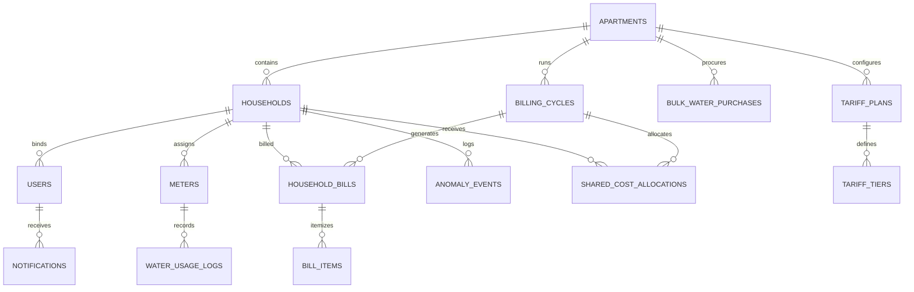

# Deployment & Demonstration Walkthrough Guide
**Project:** Smart Water Usage Monitoring and Automated Billing Management Platform  
**Target Systems:** PostgreSQL 17, Java 21 / Spring Boot 3.3.4, Node.js / React 18  

---

## 1. System Architecture & Entity-Relationship

### 1.1 High-Level Architecture

```
                    ┌─────────────────────────┐
                    │  React 18 Frontend UI   │
                    │   (Vite, Tailwind CSS)  │
                    └────────────┬────────────┘
                                 │ HTTP / REST (JWT Bearer)
                                 ▼
                    ┌─────────────────────────┐
                    │ Spring Boot 3.3 Backend │
                    │   - Spring Security     │
                    │   - Spring Data JPA     │
                    │   - Billing Engine      │
                    │   - Anomaly Detector    │
                    │   - PDFBox Invoice Gen  │
                    └────────────┬────────────┘
                                 │ JDBC / SQL
                                 ▼
                    ┌─────────────────────────┐
                    │ PostgreSQL 17 Database  │
                    │    (smart_water_db)     │
                    └─────────────────────────┘
```

### 1.2 Relational Entity-Relationship Diagram



---

## 2. Environment Configuration & Prerequisites

### Prerequisites
- **JDK:** Java Development Kit 21 (Temurin, Corretto, or Oracle)
- **Node.js:** Node.js v18+ (verified on v25.7.0) and npm
- **Database:** PostgreSQL 17 running on `localhost:5432` with database `smart_water_db`

### Environment Variables (Optional / Production Defaults)
| Variable | Default Value | Description |
| :--- | :--- | :--- |
| `SPRING_DATASOURCE_URL` | `jdbc:postgresql://localhost:5432/smart_water_db` | PostgreSQL JDBC connection URL |
| `SPRING_DATASOURCE_USERNAME`| `postgres` | Database username |
| `SPRING_DATASOURCE_PASSWORD`| `postgres` | Database password |
| `JWT_SECRET` | `404E635266556A586E3272357538782F413F4428472B4B6250645367566B5970` | 256-bit HMAC key for JWT signing |
| `ADMIN_BOOTSTRAP_SECRET` | `ADMIN-SECRET-2026` | Secret required during admin registration |

---

## 3. Step-by-Step Local Startup Guide

### Step 1: Ensure PostgreSQL is Running
Verify database availability on port 5432:
```powershell
# Windows PowerShell
Test-NetConnection -ComputerName localhost -Port 5432
```

### Step 2: Start the Backend Service
Navigate to the `backend` folder and launch via Maven:
```powershell
cd backend
mvn clean spring-boot:run
```
The backend service will boot on `http://localhost:8080`.
- **Swagger / OpenAPI Documentation:** `http://localhost:8080/swagger-ui.html`

### Step 3: Start the Frontend Application
In a separate terminal, navigate to the `frontend` folder and run Vite:
```powershell
cd frontend
npm run dev
```
The frontend application will be accessible at `http://localhost:5173`.

---

## 4. End-to-End Live Demonstration Walkthrough Script

Follow this step-by-step sequence during a live demonstration or defense presentation:

### Scene 1: Public Interface & Transparency (Phase 3)
1. Open browser to `http://localhost:5173`.
2. Inspect the **Landing Page**, showcasing the mission and architecture overview.
3. Click through **Features**, **How It Works**, and **Water Saving Tips** to demonstrate responsiveness, accessibility, and clean design tokens.

### Scene 2: Administrator Provisioning & Building Setup (Phase 1)
1. Click **Register** (`/register`).
2. Register an Administrator account:
   - Name: `Facility Manager`
   - Email: `admin@greenmeadows.local`
   - Role: `Administrator`
   - Admin Secret: `ADMIN-SECRET-2026`
3. Click **Login** and authenticate.
4. Navigate to **Apartments** (`/admin/apartments`):
   - Create new Apartment: `Green Meadows Heights`, 50 units.
5. Navigate to **Households** (`/admin/households`):
   - Add Unit `Flat A-101`, Area: 1200 sqft, Occupants: 4, Metered: Yes.
   - Add Unit `Flat A-102`, Area: 1500 sqft, Occupants: 3, Metered: Yes.
6. Navigate to **Meters** (`/admin/meters`):
   - Register meter `MTR-A101` for `Flat A-101` (Initial reading: `0.000`).
   - Register meter `MTR-A102` for `Flat A-102` (Initial reading: `0.000`).

### Scene 3: Meter Readings & Continuity Guardrails (Phase 1)
1. Navigate to **Water Readings** (`/admin/readings`):
   - Log reading for `MTR-A101`: Reading Date `2026-03-31`, Current Reading `15.500` kL.
   - Log reading for `MTR-A102`: Reading Date `2026-03-31`, Current Reading `24.500` kL.
2. Demonstrate Negative Testing / Continuity Guardrail:
   - Attempt to log reading `10.000` for `MTR-A101`.
   - Observe validation error: System rejects the decreasing reading.
3. Demonstrate Batch Upload:
   - Click **Download CSV Template** to show the standardized template format.

### Scene 4: Tariff Modeling & Bulk Water Procurement (Phase 2)
1. Navigate to **Tariff Management** (`/admin/tariffs`):
   - Create progressive tariff structure:
     - Tier 1: 0 to 10 kL @ $20.00 / kL.
     - Tier 2: > 10 kL @ $30.00 / kL.
2. Navigate to **Bulk Purchases** (`/admin/bulk-purchases`):
   - Record Tanker Purchase: Source `TANKER`, Supplier `Aquaflow Logistics`, Volume: `40.0 kL`, Total Cost: `$200.00`.

### Scene 5: Automated Billing Cycle Execution & PDF Invoice (Phase 2)
1. Navigate to **Billing Cycles** (`/admin/billing`):
   - Open billing cycle for period `2026-03-01` to `2026-03-31`.
   - Click **Calculate / Preview Bills**.
2. Explain the Automated Cost Allocation:
   - `Flat A-101` consumption = 15.5 kL, Progressive tariff = $365.00.
   - Shared tanker cost allocated proportionally (15.5 / 40.0 * $200 = $77.50).
   - Reconciled allocation sums match total procurement cost to the exact penny.
3. Click **Finalize Cycle**:
   - Status changes to `FINALIZED`.
   - Re-calculation is safely locked.

### Scene 6: Resident Portal & Itemized Statements (Phase 3)
1. Log out from Admin and Register a Resident:
   - Email: `resident@greenmeadows.local`
   - Role: `Resident`
   - Assign to Household `Flat A-101`.
2. Navigate to **Resident Dashboard** (`/resident/dashboard`):
   - Observe live metered consumption charts and conservation benchmark score.
3. Navigate to **My Bills** (`/resident/bills`):
   - View billing summary and itemized charges.
4. Click **Download PDF**:
   - Opens the generated PDF invoice `#INV-...`.
   - Displays headers, flat number, metered charges, and shared water cost.

### Scene 7: Anomaly Alerts & Security Verification (Phase 2 & 4)
1. Demonstrate Anomaly Detection:
   - Navigate to `/admin/alerts` and trigger anomaly scan.
   - Show that non-anomalous readings do not trigger false alerts and re-runs do not duplicate records.
2. Demonstrate Data Isolation Defense:
   - Attempt to request another household's bills via API or resident URL manipulation.
   - System denies access with HTTP 403 Forbidden.

---

## 5. Docker Compose Configuration (Optional Container Deployment)

For a fully containerized deployment, create `docker-compose.yml`:
```yaml
version: '3.8'

services:
  database:
    image: postgres:17-alpine
    container_name: smart_water_db
    environment:
      POSTGRES_DB: smart_water_db
      POSTGRES_USER: postgres
      POSTGRES_PASSWORD: postgrespassword
    ports:
      - "5432:5432"
    volumes:
      - pgdata:/var/lib/postgresql/data

  backend:
    build: ./backend
    container_name: smart_water_backend
    depends_on:
      - database
    environment:
      SPRING_DATASOURCE_URL: jdbc:postgresql://database:5432/smart_water_db
      SPRING_DATASOURCE_USERNAME: postgres
      SPRING_DATASOURCE_PASSWORD: postgrespassword
      JWT_SECRET: 404E635266556A586E3272357538782F413F4428472B4B6250645367566B5970
      ADMIN_BOOTSTRAP_SECRET: ADMIN-SECRET-2026
    ports:
      - "8080:8080"

  frontend:
    build: ./frontend
    container_name: smart_water_frontend
    depends_on:
      - backend
    ports:
      - "80:80"

volumes:
  pgdata:
```
